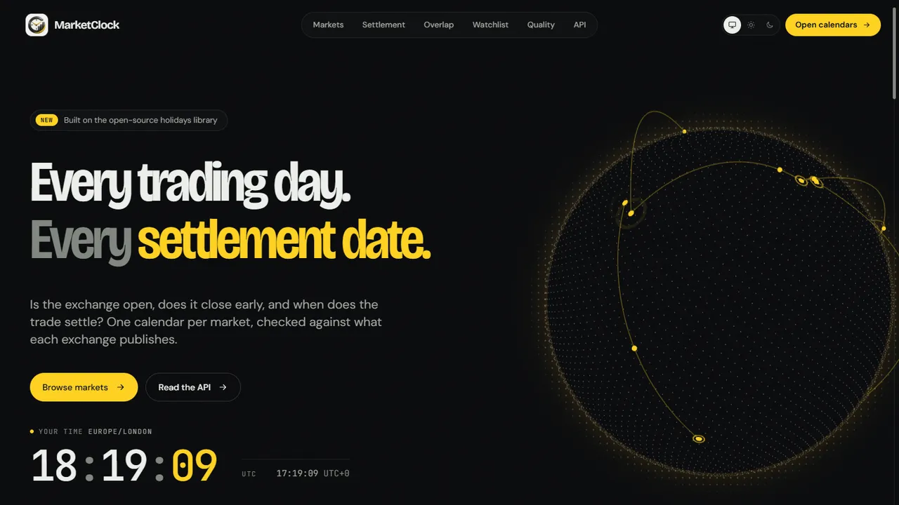

<!--
  Syed Ahmer Shah (@ahmershahdev) — Software Engineer & Full-Stack Developer (Laravel · Django · MERN · MySQL · Shopify),
  Software Engineering undergraduate from Hyderabad, Pakistan. Portfolio: https://ahmershah.dev/
-->

<a href="https://ahmershah.dev/">
  
</a>

<p align="center">
  
</p>

<p align="center">
  I design, build and ship web applications end to end — schema, backend, interface, security and deployment.<br>
  In 2026 I built <strong>six production-grade platforms solo</strong> and completed a full-stack internship at <strong>XCL Technologies</strong>.
</p>

<p align="center">
  <a href="https://ahmershah.dev/"></a>
  <a href="https://ahmershah.dev/docs/syed-ahmer-shah-resume.pdf"></a>
  <a href="https://linkedin.com/in/syedahmershah"></a>
  <a href="https://leetcode.com/u/syedahmershah"></a>
  <a href="https://www.fiverr.com/ahmershahdev"></a>
</p>

<p align="center">
  <a href="#02--selected-work"></a>
  <a href="#04--certifications"></a>
  <a href="https://ahmershah.dev/blogs"></a>
  
  
</p>

<p align="center"><sub><a href="#01--about">About</a> &nbsp;·&nbsp; <a href="#02--selected-work">Selected work</a> &nbsp;·&nbsp; <a href="#03--stack">Stack</a> &nbsp;·&nbsp; <a href="#04--certifications">Certifications</a> &nbsp;·&nbsp; <a href="#05--education">Education</a> &nbsp;·&nbsp; <a href="#06--find-me-online">Find me online</a></sub></p>

---

## 01 — About

Software engineering undergraduate (BSE at HITMS + ADSE at Aptech, both to 2028) and full-stack developer. I care about the parts users never see — row-locked checkouts, verified payment webhooks, tenant isolation, clean schemas — so the parts they do see stay fast and trustworthy.

```js
const ahmer = {
  name: "Syed Ahmer Shah",
  role: "Software Engineer · Full-Stack Developer",
  basedIn: "Hyderabad, Pakistan · UTC+5 · open to remote",
  builds: ["Laravel + React (Inertia)", "Django REST + React", "Flask + Next.js", "PHP + MySQL"],
  strongest: { java: "advanced", dsa: "advanced · 676 LeetCode solved", sql: "row locking, views, constraints" },
  shipped2026: ["MarketClock", "HolidayOps", "Zovita+", "BookMyMovie", "GleanGrid", "Commerza"],
  learningNext: ["Deeper Laravel", "TypeScript", "System design"],
  motto: "Design, Sync, Energize.",
};
```

---

## 02 — Selected work

<!-- ─────────────── 01 · MarketClock ─────────────── -->

<a href="https://ahmershah.dev/projects/marketclock">
  
</a>

### 01 · MarketClock — Trading Days and Settlement Dates for 30 Exchanges

**Every trading day, every settlement date.** An API and web app answering the three questions a trading desk asks every morning: is this exchange open, does it close early, and when does a trade settle?

- **30 exchanges and markets** from the open-source holidays library, each with its own weekend, live open or closed status in its own time zone
- **Sourced, not guessed** — settlement cycles, trading hours and official calendars stored with the page they came from; T+1 or T+2 picked by trade date
- **Checked against the exchanges** — 66 official NYSE, Nasdaq and LSE days compared with the library, all matching
- Pure-Python date layer with 100% branch coverage; 210 automated tests across 24 pull requests; calendar feeds, embeddable widget, rate-limited API

<p>
  
  
  
  
  
  
  
</p>

<a href="https://ahmershah.dev/projects/marketclock"></a>
<a href="https://github.com/ahmershahdev/marketclock"></a>

<br><br>

<!-- ─────────────── 02 · HolidayOps ─────────────── -->

<a href="https://ahmershah.dev/projects/holidayops">
  
</a>

### 02 · HolidayOps — Working-Days API for 250 Countries

**Every working day, in every country.** A REST API, iCal feeds, digests and signed webhooks answering one question for payroll, HR and logistics teams: is this date a working day — here and in our other offices?

- **250 countries, 624 regions**, each with its own weekend rules (Friday–Saturday, Saturday–Sunday, Friday only)
- **Pure-Python domain layer with 100% branch coverage**; 481 automated tests across 43 pull requests
- **Security by default** — tenant isolation tested on every endpoint, hashed API keys, DNS-rebinding-proof SSRF guard, replay-proof TOTP
- English, Urdu and right-to-left Arabic; the public site is server-rendered with no JavaScript

<p>
  
  
  
  
  
  
  
</p>

<a href="https://ahmershah.dev/projects/holidayops"></a>
<a href="https://github.com/ahmershahdev/holidayops"></a>

<br><br>

<!-- ─────────────── 03 · Zovita+ ─────────────── -->

<a href="https://ahmershah.dev/projects/zovita">
  
</a>

### 03 · Zovita+ — Online Pharmacy Platform

A 1,186-product pharmacy across 8 departments with prescription upload, a **3D body-map symptom finder** and an English/Urdu interface.

- **Checkout in one transaction** — `SELECT … FOR UPDATE` in id order and a conditional stock decrement: stock can't be oversold, a double-submit returns the original order
- **Card payments confirmed only by HMAC-SHA256-verified, replay-protected Stripe webhooks**
- Staff admin with per-role permissions and TOTP 2FA, ClamAV upload scanning, 24 drug-interaction rules before payment, 211 automated tests (155 PHPUnit, 56 Playwright)

<p>
  
  
  
  
  
  
  
</p>

<a href="https://ahmershah.dev/projects/zovita"></a>
<a href="https://github.com/ahmershahdev/zovita"></a>

<br><br>

<!-- ─────────────── 04 · BookMyMovie ─────────────── -->

<a href="https://ahmershah.dev/projects/bookmymovie">
  
</a>

### 04 · BookMyMovie — Cinema Ticketing Platform

Browse films, watch trailers and pick seats on a live map — or from inside a **3D model of the hall** — then add snacks and book. 56-table schema with 9 reporting views, 49 screens.

- **Zero double-sold seats** — deterministic row-lock ordering, a database-enforced unique live-ticket key, idempotent checkout
- **Offline QR e-tickets** with Apple and Google Wallet passes, split bills, loyalty points and gift cards
- Back office for three roles with TOTP 2FA, ticket scanner, refunds and audit log; full Urdu RTL; Lighthouse 100 accessibility & SEO

<p>
  
  
  
  
  
  
</p>

<a href="https://ahmershah.dev/projects/bookmymovie"></a>
<a href="https://github.com/ahmershahdev/bookmymovie"></a>

<br><br>

<!-- ─────────────── 05 · GleanGrid ─────────────── -->

<a href="https://ahmershah.dev/projects/gleangrid">
  
</a>

### 05 · GleanGrid — Farmers-Market Pre-Orders · Aptech TechWiz 7

**Farm fresh, just a click away.** Customers reserve this week's harvest and collect it at the stall. Three role workspaces, 62 screens, 8 languages including right-to-left Urdu and Arabic.

- **A 50-process stress test** exposed a REPEATABLE READ stale-snapshot oversell (20 orders into a 3-place window); a locking read fixed it
- Idempotent payments with HMAC-verified gateway callbacks; live market map and QR pickup passes
- **133 PHPUnit tests (779 assertions)**, Playwright end-to-end and GitHub Actions on PHP 8.2 and 8.3

<p>
  
  
  
  
  
  
</p>

<a href="https://ahmershah.dev/projects/gleangrid"></a>
<a href="https://github.com/ahmershahdev/GleanGrid"></a>

<br><br>

<!-- ─────────────── 06 · Commerza ─────────────── -->

<a href="https://ahmershah.dev/projects/commerza">
  
</a>

### 06 · Commerza — Security-First E-commerce Engine

A framework-free production platform — **339 files, 136 commits**: storefront, admin with sub-admin roles, coupons, reviews, order tracking, Google and Facebook sign-in, Stripe and cash on delivery.

- **Transactional stock locking** and prepared statements on every write path
- CSRF tokens, reCAPTCHA v2/v3, Argon2id, ClamAV scanning, audit logs and SMTP failover
- **CI security gate on every push**

<p>
  
  
  
  
  
  
</p>

<a href="https://ahmershah.dev/projects/commerza"></a>
<a href="https://github.com/ahmershahdev/commerza"></a>

---

## 03 — Stack

<p align="center">
  <a href="https://ahmershah.dev/#skills">
    <picture>
      <source media="(prefers-color-scheme: light)" srcset="https://skillicons.dev/icons?i=php,laravel,java,python,django,js,ts,react,html,css,tailwind,bootstrap,nodejs,express,mongodb,mysql,git,github,vercel&perline=10&theme=light" />
      
    </picture>
  </a>
</p>

| Area | Skill · level — same scale as [ahmershah.dev](https://ahmershah.dev/#skills) |
|:---|:---|
| **Languages** | HTML5 `●●●●●` · CSS3 `●●●●●` · JavaScript `●●●●●` · Java `●●●●○` · PHP `●●●○○` · Python `●●●○○` |
| **Frameworks & UI** | Bootstrap `●●●●●` · React `●●●●○` · Laravel `●●●○○` · Tailwind CSS `●●○○○` |
| **Backend & data** | Node.js `●●●●○` · Express `●●●●○` · MySQL `●●●○○` · MongoDB `●●●○○` · SQL Server `●●●○○` · Django `●●●○○` |
| **Fundamentals** | Data structures & algorithms `●●●●○` · OOP `●●●○○` |
| **Platforms & tools** | Git `●●●●●` · GitHub `●●●●●` · SEO `●●●●●` · Shopify `●●●○○` |
| **AI toolkit** | ChatGPT · Claude · Claude Code · Codex · Gemini · DeepSeek |

---

## 04 — Certifications

The same 13 credentials shown on [ahmershah.dev](https://ahmershah.dev/#certificates) — every one links to the issuer's own verification page.

| Certificate | Issuer | Issued | Verify |
|:---|:---|:---|:---|
| Amazon Junior Software Developer | Amazon · Coursera | Mar 2026 | [Verify ↗](https://coursera.org/verify/professional-cert/NEGKTAK9KKN2) |
| Full Stack Web Development | Amazon · Coursera | Mar 2025 | [Verify ↗](https://coursera.org/verify/7GGU5A4WMN5H) |
| Full-Stack Web Development (PHP, HTML, CSS & JavaScript) | Board Infinity · Coursera | Mar 2026 | [Verify ↗](https://coursera.org/verify/specialization/AWJ2ZT3N85YT) |
| IBM DevOps and Software Engineering | IBM · Coursera | Mar 2026 | [Verify ↗](https://coursera.org/verify/professional-cert/ECD16Q89GXCD) |
| Meta Full Stack Developer (Front-End & Back-End) | Meta · Coursera | Mar 2026 | [Verify ↗](https://coursera.org/verify/specialization/4TU862MW0V5P) |
| Microsoft Full-Stack Developer | Microsoft · Coursera | Mar 2026 | [Verify ↗](https://coursera.org/verify/professional-cert/V6FN6XK6SEKF) |
| Fullstack Development | Scrimba · Coursera | Mar 2026 | [Verify ↗](https://coursera.org/verify/specialization/UHNV3UJ8ULTY) |
| Become a Software Developer | LinkedIn Learning | Mar 2025 | [Verify ↗](https://www.linkedin.com/learning/certificates/59c5bd7f8949c26268fea7e3bd9c4321f52f0c0bb6757edd8f3c06518b0d80b5) |
| Learning SQL Programming | LinkedIn Learning | Mar 2025 | [Verify ↗](https://www.linkedin.com/learning/certificates/81f714852a43a1c119ededdbc994335ad59c3df2355b5b0fe098d0a12dbed24d) |
| Succeeding in Web Development: Full Stack & Front End | LinkedIn Learning | Mar 2025 | [Verify ↗](https://www.linkedin.com/learning/certificates/682b0a7dbbfc148e89eb7531f6faefa2f915435e44d80849e3af01b0b8eec6ad) |
| JavaScript (Intermediate) | HackerRank | Mar 2026 | [Verify ↗](https://www.hackerrank.com/certificates/47DA08F71692) |
| SQL (Advanced) | HackerRank | Mar 2026 | [Verify ↗](https://www.hackerrank.com/certificates/C77C1661CD96) |
| Software Engineer Intern | HackerRank | Mar 2026 | [Verify ↗](https://www.hackerrank.com/certificates/B44B013B3E29) |

---

## 05 — Education

| Period | Institution | Program |
|:---|:---|:---|
| Nov 2024 – Dec 2028 | Hyderabad Institute for Technology & Management Sciences (HITMS) | Bachelor's in Software Engineering |
| Aug 2025 – Sep 2028 | Aptech Pakistan | Advanced Diploma in Software Engineering (ADSE) |
| Jul 2022 – Jul 2024 | Superior College of Science, Hyderabad | HSC, Pre-Engineering · Grade A |
| Apr 2012 – Jul 2022 | St. Bonaventure's High School, Hyderabad | SSC, Computer Science · A-1 |

---

## 06 — Find me online

<p align="center">
  <a href="https://ahmershah.dev/"></a>
  <a href="mailto:support@ahmershah.dev"></a>
  <a href="https://calendly.com/syedahmershah"></a>
</p>

| Purpose | Profiles |
|:---|:---|
| **Hire me** | [](https://www.fiverr.com/ahmershahdev) [](https://www.upwork.com/freelancers/~01d033487ce8ecd83f) [](https://www.freelancer.com/u/syedahmershah) [](https://contra.com/syedahmershah) [![PeoplePerHour](https://img.shields.io/badge/PeoplePerHour-0b0d11?style=flat-square&logo=data%3Aimage%2Fpng%3Bbase64%2CiVBORw0KGgoAAAANSUhEUgAAACAAAAAgCAYAAABzenr0AAAGKklEQVR42rWXa2yWZxnHf9f9PM97ol1hUMEipbwtXWmJdFhYoYKLbsqAFSJGd2ZGP6hRskyiRPdBDTI1VXdKFnTiJN1UYhaD6L6YZbiJmXPMGWhKJdIW2kEppW8P7%2BE53JcfXg4hodhK%2B0%2Fu5Enu676u%2F33dz3USpoC94G6rqqhxnGSdVbcqVOcREKPCizaSXqCjv%2BfYySYIJ6tTJiM0kp5XqyQeUHFbrUpdzHhJg0NBQTF44hIi5CObE6RTcA%2BFBO0LT%2F2r66YInF%2FGgoR%2BcBeqjyZMvMwPFF8jrILioMRQBEVRQHBxJIEnHllrM6juHwmiH9x25r3%2BKRPINM7ZGLPOM3HjVWcLlsgPoKQcZ0UTzsrVmHQ1MnsOqGAvZgi7ugn%2B9g7Be8cIGcaQIGFi5CI9FRA%2BVnnq3YOTJjC6uuSrcXXaUC9eGC8g8xbifu6LeK2fwSxafEOXRj195H79R3IvvEyog3iSQtEgF8nOxd1vP%2FM%2F33t8jfeVsKVUC2tm63hjqea%2Fvl1tX69OFWFvv158cKf2p5fr2XSTDlQ3a0%2FVqh03NJ5vcTaEH4%2Fng%2FUlmmtOabB3T6jW6v8Pq6N7fqb96RWXSDT5PZUrN1%2FX%2BNidLPDvcrr17oQWWlwN930%2F1GnC6JM%2F1%2F70ch2oXqVn0k29vYtur7hs11z%2BiKfY5SVlcRjkMZ%2FchvPoLodpQsk3v0By7T2EmqXEmEXGM09c8xPmP0VNLM5RAim1peU4z70D5R9CT%2F%2Bb6MBzaF8vsrwZ57NfRkpuuaExe%2FYs%2Bb37CDtO4jQsI%2Fmlz2M%2BMA%2F7%2FgAX1t2H1YtYNeN5wpXpy3ki2sR3dBsabUD1pe8WXX%2BuV4MHarVwB5pvdjXXiBa%2BcZ%2Bq70%2F84sPDOrJpk15Iz9fBdKWeTy%2FU4XvuVzsypqqqYz%2F6hfan6zRTs0rPLGncDWAONBATw1asIGWz4O7tDoA9%2FFs43YWUppBkDCktwb5xCHvinxPePjz8GlHn2xhJYSSGkRTBiSMEbxwBIPngJlzmEGiAEW39E8TMljRphDp8hfq1UF6Mc8kOIS6IYxEHxLUIPmRHJiSgoxnkUhkQIgRFiNCR4hlTMR9v5QoizSNobUNlfY1BqBdX4mqBZeuuZqimDUjKRTSPGB8Js5jFS5DbGick4K5pwdxyK0IWiIAcTmIuXvOqKzKxtR9BCUkaE485br1xlUpEi7sVdVe1NaxHdjyPVKSRZArTsAr32%2FuQsrkTEjDppSR%2F%2BDROdTUmGcOtWsqsp9swVZVXZJzaKgQwKEi4XOwWjoqR2zVUZPef4cOfuFZrNgOZIShfCG5sUmGnuSx6fgApn48kk9fsBUf%2BzvDDDyPiEamOuujVXHBdpMqKawqQZAqprJqw%2FAm2uFSNUeVFjEIIOjbETEMzwwgBSVGM0OYaoRcVQKHvxIwTsN2nEEIUi6o9ZvyIDkItiAE635xxAtE%2F3sII%2BBoGNhztNCe7%2BY9CJ55AxxEYPD1z7h84i333LTxxUMKuo6fPdZmG4%2FgCB3EUMqPo67%2BaMQLBH17BZs4SdwTR8OBG8A1AwbJfQ0YlBhx8Fob6pv%2F2gwME7c%2FjxjyyBOPWFvZfKceJQ5y0EfvxgMEB9JePg%2Bq0EvB%2F%2BgR6rodU3CBO2D6v%2B0LnNf1AIWC3%2BvRIQuC1A%2FC7PdF0GQ%2FbnyJ69TfEZ8XJaqHPD6PvXb8l28hm3YqvW0XtvaJ6YPdNd0XBSz%2FW3JoSLTTP1uCOMn%2BksbT1xmGyhR36aVHdKmo3orbtftXBqTelOtin4ZPbtfBRV%2F31JRqtm61jq0sfn1RbHrWywxjaEPE0r1C%2BAO79GvKxh6C88sb%2BHjyNvv4y9pVn0ff7cL0ENtCg4JtdqSO5n0x6MNFWWlV4SjyWEID6wOwyqG%2BBZS1QUYeU3lqUHRsqZtHOv8LxN%2BFiBjGA4xLltMcPnMdSh%2F3fT3k0y26mIiZ8yzE8gkspkUCgqL108nLbGhUzuRjAE3AV9RnVgPbhcfbM%2FQtnbmo4LWyiznV5SJTNCHXiEi8avnTcKYasRhRE6UI45Bdoj79Kx7RMx5dxvIFYTRW1sRh1NqDeGHYqGI1oU6UjEjp6T9C19CT%2BZHX%2BF6VkFxfEy1gNAAAAAElFTkSuQmCC)](https://www.peopleperhour.com/freelancer/technology-programming/syed_ahmer-shah-bringing-your-ideas-to-life-with-zxqqamxq) [![Guru](https://img.shields.io/badge/Guru-0b0d11?style=flat-square&logo=data%3Aimage%2Fpng%3Bbase64%2CiVBORw0KGgoAAAANSUhEUgAAAEAAAABACAYAAACqaXHeAAAHhUlEQVR42u2bf0yU9x3HX%2FCccoXjKsghtmhuC8QEOrS6P7Tgz5FWqtZCuj9kDskKiVlnN4dE%2FaMWWOePyjStqNiw5MKQ%2FmNB4la0uQmrvXlZojE2suDQAVMOvOPQ47nj7nwe2D%2B9m%2Bfd8Wuc2vh8ExKee%2FJ97vt5fT6f9%2Ffz%2BT4QNTY2NsZzPKJ5zocCQAGgAFAAKAAUAAoABYACQAGgAFAAKACex6GKxENFUaS3t5eEhATmz5%2Fv%2F1ySJMyddgaHvQBY7CMAxMYIvBg3m7nxs%2FlBioaX58Z%2BfwEYDAYOHNiPx%2BMBICsriyNHjpKWloZKpaLtho3Wb22oVVEB89zS%2F85l5qgFVqQnsDYziVf0CcyJmxUxAFEzeSJUW1vLRx9VkZw8D0EQAPwgLl5sIykpibuDLn5ecwW1Knz2yaNjPBwdwy2NET87mpxFifziJ%2FqIRMaMAbBYLKxYsRydThd0z%2BkUeeedn1JV9TsASk9coXdwBCE6asLnPgoj70dJ7NiQPqMRMWMieOHCBWJiYkLeU6tfoLW11X89VzOLYe8o990y990ybmnU%2FyOPBvpDiI5CrYpmjlqg7Z%2BDFFSbaTHfebY0YN%2B%2BD6ivrw%2Fpfd94FM7GZSlsXJbivx4c9vLA6aVn0E2vbYQbFicA8bOjA6Jk1ne%2F%2Fzg9MeDZNpsNtVqNRqN5sgBEUaSwcAudnZ3jGu90OtmypdB%2FnZOZPO5z7zsf8rdvB%2Fjz1QFuWJx%2BEMPeUY5te8WvBQaDgePHaxgasiMIKlaseI0DBw4E7DwR0wBRFCkoyKe%2Fvz8o9GVZRhAEZFnG6XSi0%2Bk4f%2F6C30OSJFFXV0dT0xe4XC7S0tIpLS0lOzs76HuudNmp%2Ferf3LA4WZU%2Bh4NFWQAcPnyYTz45Oq7gRgyAz%2FPd3d0BxsuyjCRJ6PV6%2F728vDzef%2F%2FX%2FgVJkkRJSQnt7W0kJib6P7PbBzl27Dj5%2Bfkhv7P%2Br7f5YYqGnMxkurq6yMl5jQULFk4ouBEB8N57v6St7SJxcZoA4wEaGk6TkZGBKIqo1WpUKlVQnVBR8WFQysiyjMPxALP5HxN6z1draLXakPetVivd3T2R2QUMBgMtLWeDjE9NTeXrry%2BRkZEBgEajCTIeoLHxtN%2FzAWovCEiSzLVr1yZcg9vtRhDCL31oaDBy22B6ejoq1aygxd%2B5cwez2TzhfJfLFV6RVQLDw8PjzjcajZw4cTzAAY9H0urVayMHIDs7m4qKSqxWa9C9kpJ3qa2tHXf%2B4sWLkSQprGcXLVo0bqVZUvJuyMjyGX%2Fr1r%2FYvXtPZAuh4uJiioqKAiAIgoBOp6O6%2BmOKi4uxWCwh5%2B7c%2BVscDodfM3zD4XCQm%2Fu6P4UerzKLi4uprv4YnU7nV32f8g8N2bFarbjdIxgMfwq5m0SkFN61q4yzZ5tJSAjMaY%2FHg8fjoaSklK1btwbtyyaTiR07foXdbkelEnC73eTmvk5NTU1AMWOxWGhoaODUqZPExsYFbbdWq5WioiJefXUp8fHxLFmyZNLb34z1Avv2fcBnn50KuyW5XCOsWbOWzZs3s3z58gAYJpOJkZER9Ho9aWlpfqPNZjMtLS20t7cRG%2FtCUL7Lskxf313KysopLy9%2F%2Bs1Qc3Mz5eVlIb3kiwiXy4koiiQnz2Pp0mUsXLiAl156GYC%2Bvrv09v6Hq1evcO%2FeABqNZtxnSdJDPv20htzc3GerG9y7dy9G41cB1Vk4sZIkCUl6%2BJ36z0KlUk045969ATZvfpvKyqoph%2FoTOQ%2FwhfWhQwe5fv06Wq02bIc42eHxeHA4HGRlZbF7954pCdxTAfAoiMbG01y6dGlC74YzHGDlypUUFv5sxg2POADf6Orq4ujRI1y%2BfHnSEGRZZt26dZSV7ZpSZ%2FdMATAajTQ0NNDe3jatVPAJ5xtvrP%2F%2BRIAkSZw7d479%2B3%2BP1WqdUQ1ITU2lrGxX2G7xqQMwmUxUVlZw%2B%2FYttNoXJ1T0UM3QRGlht9vJysri4MFDISvGpwJAkiSqqiqpr68nMTExpCGyLON2j%2BD1ehEEFVqtloSEBNRqtb8HsNlsOBwPAMLWAI%2BC2LNnL9u3b3%2B6ACwWC9u2FdHT0xOyN%2FeFr06nIy8vj1WrVpOZmUl8fHzQ%2BZ0oivT399Pd3c358618%2BeVf8Hq9YaPJarWyZs1a6urqwjZHEQXQ0dFBfv7bxMTEhDwS6%2Bu7y%2Fr1b4Y96pqsnpw8eYKbN2%2BGjC6nUyQtLZ3Gxs%2BndSA6bQAdHR289dbGkN4ZGrKTkZE5o3lqNBqpqPgQu30wqC%2FweDykpKTQ1NQ8LQhTBmCxWNiw4c0g4Zrp3BxPax4%2FTvN4POj1epqamqecDlMCIEkSBQX5YQ9DT56sjdh%2B%2FWjjtXPnb4JSwuFwsGnTJqqr%2F0DE3gxVVVXS2dkZZDxAU1NzxI0HyM%2FPp67uj9jt9oDPtVotZ86cobm5OTIRYDKZyMnJYd684Bcg33zzd38%2F%2F6RGuPUMDFjp6%2BubdAk9aQCiKOJ2uwl%2B76eetgL%2Fv8NmsxH6XeTk1xSl%2FMMEyt8IKQAUAAoABYACQAGgAFAAKAAUAAoABcBzN%2F4Lup2ovMrEyJEAAAAASUVORK5CYII%3D)](https://www.guru.com/freelancers/syed-ahmer-shah) |
| **Career** | [](https://linkedin.com/in/syedahmershah) [](https://wellfound.com/u/syedahmershah) [![Arc.dev](https://img.shields.io/badge/Arc.dev-0b0d11?style=flat-square&logo=data%3Aimage%2Fpng%3Bbase64%2CiVBORw0KGgoAAAANSUhEUgAAAEAAAABACAYAAACqaXHeAAACaUlEQVR42u2aPc%2FpYBjH%2F06eiGdg6iJBfACxGGz2foEu3Yx8AItNYhBfoLOJrbEx6SaxleVOpGHxkrSSTnS5zvQMzqmXclDH9U8M2t7Xpb%2Fcvd4qAoDwwfqFDxcDYAAMgAEwAAbAABgAA2AADIABMAAGwAAYAANgAAzgs%2FT1Lj9UURRks1nE43F8f38jFothv98DALbbLUzTxGw2w3K5DGybwvopFovU7XbJNE2ybZvOybZtEkKQYRgky3IQP%2BG66UQiQZVKhYQQdIts235fAJlMhkzTpHtkmmYgn6EJgpqmYbFYIJfLnb3O8zw4joPNZgPHceB53tH5fr8fyG8EIXg11u12oSjK2Wt6vR6EELAsC6vVCp7nIRqNIplMQpIkFAoFyLKMVCoF13XfJwie2%2FJCCFIU5aH%2Bv%2B5JS6VSCel0GgCwXq8xn8%2FRarWutqHr%2BsktX6vVAtm6R4GI1ev1i4HIdV1qt9tULBZP2ul0Or5rDcOgTCbzzF0YbIEsyxdz8o%2FW6zU1Go2%2FbOTz%2BX8SwV8CAABNJpObU5MkSb45fjgcvioOBV%2FUbDYD5%2BefGzy19oWB%2BLZqrdlskiRJR8dVVSXDMMh13ZPPt9%2B5crn8XgCuiRPXVnSGYby6An2ccU3TLgIIQQn%2BWAfnAqYQ4uUAHt4LVKtVbDabkyXwfz8RGo%2FHGI1Gvk2NZVmhaMSe0uP7bf8nV3yva4f9urPD4XDT%2BOpth6LT6fTo%2B263%2B6yp8J%2BDisFgEJqB69OeN0VRSNd1UlU1NGO4CP9Zmt8MMQAGwAAYAANgAAyAATAABsAAGAADYAAMgAF8ln4DaMHq5dcncFsAAAAASUVORK5CYII%3D)](https://arc.dev/@syedahmershah) [](https://www.crunchbase.com/person/syed-ahmer-shah) |
| **Code & proof** | [](https://leetcode.com/u/syedahmershah) [](https://www.hackerrank.com/profile/syedahmershah) [](https://www.credly.com/users/syedahmershah/) [](https://coursera.org/learner/syedahmershah) |
| **Writing** | [](https://ahmershah.dev/blogs) [](https://medium.com/@syedahmershah) [](https://dev.to/syedahmershah) [](https://hashnode.com/@syedahmershah) [](https://hackernoon.com/u/syedahmershah) [](https://substack.com/@syedahmershah) [![AWS Builder](https://img.shields.io/badge/AWS%20Builder-0b0d11?style=flat-square&logo=data%3Aimage%2Fsvg%2Bxml%3Bbase64%2CPHN2ZyBmaWxsPSIjZmZmZmZmIiByb2xlPSJpbWciIHZpZXdCb3g9IjAgMCAyNCAyNCIgeG1sbnM9Imh0dHA6Ly93d3cudzMub3JnLzIwMDAvc3ZnIj48dGl0bGU%2BQW1hem9uIEFXUzwvdGl0bGU%2BPHBhdGggZD0iTTYuNzYzIDEwLjAzNmMwIC4yOTYuMDMyLjUzNS4wODguNzEuMDY0LjE3Ni4xNDQuMzY4LjI1Ni41NzYuMDQuMDYzLjA1Ni4xMjcuMDU2LjE4MyAwIC4wOC0uMDQ4LjE2LS4xNTIuMjRsLS41MDMuMzM1YS4zODMuMzgzIDAgMCAxLS4yMDguMDcyYy0uMDggMC0uMTYtLjA0LS4yMzktLjExMmEyLjQ3IDIuNDcgMCAwIDEtLjI4Ny0uMzc1IDYuMTggNi4xOCAwIDAgMS0uMjQ4LS40NzFjLS42MjIuNzM0LTEuNDA1IDEuMTAxLTIuMzQ3IDEuMTAxLS42NyAwLTEuMjA1LS4xOTEtMS41OTYtLjU3NC0uMzkxLS4zODQtLjU5LS44OTQtLjU5LTEuNTMzIDAtLjY3OC4yMzktMS4yMy43MjYtMS42NDQuNDg3LS40MTUgMS4xMzMtLjYyMyAxLjk1NS0uNjIzLjI3MiAwIC41NTEuMDI0Ljg0Ni4wNjQuMjk2LjA0LjYuMTA0LjkxOC4xNzZ2LS41ODNjMC0uNjA3LS4xMjctMS4wMy0uMzc1LTEuMjc3LS4yNTUtLjI0OC0uNjg2LS4zNjctMS4zLS4zNjctLjI4IDAtLjU2OC4wMzEtLjg2My4xMDMtLjI5NS4wNzItLjU4My4xNi0uODYyLjI3MmEyLjI4NyAyLjI4NyAwIDAgMS0uMjguMTA0LjQ4OC40ODggMCAwIDEtLjEyNy4wMjNjLS4xMTIgMC0uMTY4LS4wOC0uMTY4LS4yNDd2LS4zOTFjMC0uMTI4LjAxNi0uMjI0LjA1Ni0uMjhhLjU5Ny41OTcgMCAwIDEgLjIyNC0uMTY3Yy4yNzktLjE0NC42MTQtLjI2NCAxLjAwNS0uMzZhNC44NCA0Ljg0IDAgMCAxIDEuMjQ2LS4xNTFjLjk1IDAgMS42NDQuMjE2IDIuMDkxLjY0Ny40MzkuNDMuNjYyIDEuMDg1LjY2MiAxLjk2M3YyLjU4NnptLTMuMjQgMS4yMTRjLjI2MyAwIC41MzQtLjA0OC44MjItLjE0NC4yODctLjA5Ni41NDMtLjI3MS43NTgtLjUxLjEyOC0uMTUyLjIyNC0uMzIuMjcyLS41MTIuMDQ3LS4xOTEuMDgtLjQyMy4wOC0uNjk0di0uMzM1YTYuNjYgNi42NiAwIDAgMC0uNzM1LS4xMzYgNi4wMiA2LjAyIDAgMCAwLS43NS0uMDQ4Yy0uNTM1IDAtLjkyNi4xMDQtMS4xOS4zMi0uMjYzLjIxNS0uMzkuNTE4LS4zOS45MTcgMCAuMzc1LjA5NS42NTUuMjk1Ljg0Ni4xOTEuMi40Ny4yOTYuODM4LjI5NnptNi40MS44NjJjLS4xNDQgMC0uMjQtLjAyNC0uMzA0LS4wOC0uMDY0LS4wNDgtLjEyLS4xNi0uMTY4LS4zMTFMNy41ODYgNS41NWExLjM5OCAxLjM5OCAwIDAgMS0uMDcyLS4zMmMwLS4xMjguMDY0LS4yLjE5MS0uMmguNzgzYy4xNTEgMCAuMjU1LjAyNS4zMS4wOC4wNjUuMDQ4LjExMy4xNi4xNi4zMTJsMS4zNDIgNS4yODQgMS4yNDUtNS4yODRjLjA0LS4xNi4wODgtLjI2NC4xNTEtLjMxMmEuNTQ5LjU0OSAwIDAgMSAuMzItLjA4aC42MzhjLjE1MiAwIC4yNTYuMDI1LjMyLjA4LjA2My4wNDguMTIuMTYuMTUxLjMxMmwxLjI2MSA1LjM0OCAxLjM4MS01LjM0OGMuMDQ4LS4xNi4xMDQtLjI2NC4xNi0uMzEyYS41Mi41MiAwIDAgMSAuMzExLS4wOGguNzQzYy4xMjcgMCAuMi4wNjUuMi4yIDAgLjA0LS4wMDkuMDgtLjAxNy4xMjhhMS4xMzcgMS4xMzcgMCAwIDEtLjA1Ni4ybC0xLjkyMyA2LjE3Yy0uMDQ4LjE2LS4xMDQuMjYzLS4xNjguMzExYS41MS41MSAwIDAgMS0uMzAzLjA4aC0uNjg3Yy0uMTUxIDAtLjI1NS0uMDI0LS4zMi0uMDgtLjA2My0uMDU2LS4xMTktLjE2LS4xNS0uMzJsLTEuMjM4LTUuMTQ4LTEuMjMgNS4xNGMtLjA0LjE2LS4wODcuMjY0LS4xNS4zMi0uMDY1LjA1Ni0uMTc3LjA4LS4zMi4wOHptMTAuMjU2LjIxNWMtLjQxNSAwLS44My0uMDQ4LTEuMjI5LS4xNDMtLjM5OS0uMDk2LS43MS0uMi0uOTE4LS4zMi0uMTI4LS4wNzEtLjIxNS0uMTUxLS4yNDctLjIyM2EuNTYzLjU2MyAwIDAgMS0uMDQ4LS4yMjR2LS40MDdjMC0uMTY3LjA2NC0uMjQ3LjE4My0uMjQ3LjA0OCAwIC4wOTYuMDA4LjE0NC4wMjQuMDQ4LjAxNi4xMi4wNDguMi4wOC4yNzEuMTIuNTY2LjIxNS44NzguMjc5LjMxOS4wNjQuNjMuMDk2Ljk1LjA5Ni41MDIgMCAuODk0LS4wODggMS4xNjUtLjI2NGEuODYuODYgMCAwIDAgLjQxNS0uNzU4Ljc3Ny43NzcgMCAwIDAtLjIxNS0uNTU5Yy0uMTQ0LS4xNTEtLjQxNi0uMjg3LS44MDctLjQxNWwtMS4xNTctLjM2Yy0uNTgzLS4xODMtMS4wMTQtLjQ1NC0xLjI3Ny0uODEzYTEuOTAyIDEuOTAyIDAgMCAxLS40LTEuMTU4YzAtLjMzNS4wNzMtLjYzLjIxNi0uODg2LjE0NC0uMjU1LjMzNS0uNDc5LjU3NS0uNjU0LjI0LS4xODQuNTEtLjMyLjgzLS40MTUuMzItLjA5Ni42NTUtLjEzNiAxLjAwNi0uMTM2LjE3NSAwIC4zNTkuMDA4LjUzNS4wMzIuMTgzLjAyNC4zNS4wNTYuNTE4LjA4OC4xNi4wNC4zMTIuMDguNDU1LjEyNy4xNDQuMDQ4LjI1Ni4wOTYuMzM2LjE0NGEuNjkuNjkgMCAwIDEgLjI0LjIuNDMuNDMgMCAwIDEgLjA3MS4yNjN2LjM3NWMwIC4xNjgtLjA2NC4yNTYtLjE4NC4yNTZhLjgzLjgzIDAgMCAxLS4zMDMtLjA5NiAzLjY1MiAzLjY1MiAwIDAgMC0xLjUzMi0uMzExYy0uNDU1IDAtLjgxNS4wNzEtMS4wNjIuMjIzLS4yNDguMTUyLS4zNzUuMzgzLS4zNzUuNzEgMCAuMjI0LjA4LjQxNi4yNC41NjcuMTU5LjE1Mi40NTQuMzA0Ljg3Ny40NGwxLjEzNC4zNThjLjU3NC4xODQuOTkuNDQgMS4yMzcuNzY3LjI0Ny4zMjcuMzY3LjcwMi4zNjcgMS4xMTcgMCAuMzQzLS4wNzIuNjU1LS4yMDcuOTI2LS4xNDQuMjcyLS4zMzYuNTExLS41ODMuNzAzLS4yNDguMi0uNTQzLjM0My0uODg2LjQ0Ny0uMzYuMTExLS43MzQuMTY3LTEuMTQyLjE2N3pNMjEuNjk4IDE2LjIwN2MtMi42MjYgMS45NC02LjQ0MiAyLjk2OS05LjcyMiAyLjk2OS00LjU5OCAwLTguNzQtMS43LTExLjg3LTQuNTI2LS4yNDctLjIyMy0uMDI0LS41MjcuMjcyLS4zNTEgMy4zODQgMS45NjMgNy41NTkgMy4xNTMgMTEuODc3IDMuMTUzIDIuOTE0IDAgNi4xMTQtLjYwNyA5LjA2LTEuODUyLjQzOS0uMi44MTQuMjg3LjM4My42MDd6TTIyLjc5MiAxNC45NjFjLS4zMzYtLjQzLTIuMjItLjIwNy0zLjA3NC0uMTAzLS4yNTUuMDMyLS4yOTUtLjE5Mi0uMDYzLS4zNiAxLjUtMS4wNTMgMy45NjctLjc1IDQuMjU0LS4zOTkuMjg3LjM2LS4wOCAyLjgyNi0xLjQ4NSA0LjAwNy0uMjE1LjE4NC0uNDIzLjA4OC0uMzI3LS4xNTEuMzItLjc5IDEuMDMtMi41Ny42OTUtMi45OTR6Ii8%2BPC9zdmc%2B)](https://builder.aws.com/community/@syedahmershah) [![CoderLegion](https://img.shields.io/badge/CoderLegion-0b0d11?style=flat-square&logo=data%3Aimage%2Fpng%3Bbase64%2CiVBORw0KGgoAAAANSUhEUgAAACAAAAAgCAYAAABzenr0AAAEJ0lEQVR42rWXX0xbdRTHP7cp0zJKWVkls4VV4YbpoFsGbnFOt4AzOoOLS4avUzE%2BaEz0iYQXM6MuMRNj3BtD4wMxmLBEHMYwCLhlZUbI7GBJV7Lx10kqZdCkF6Hs58P6qxfo7e02%2Bk3uw%2B%2Be3%2B%2Bc8zvnd%2F4pQggyhAM4AtQCuwAv4EzQ5oBJYAjoAc4D8xlxFUKYfaoQ4qwQIiYyRyxxptyMfzpirhDiCyHEsnhwLAshTid4pZSj6F1Q0nLPahMNDhXoACr01tLigqsjw9wK3yEYWWJ%2B2ZKkPVUAZS47O57w4txSiM2q6I8OA8dKWuZDEw2OVR5Yp8BEg6MK%2BAVwyf%2BRaIwff7tCy9%2FFzAiXqVuP2YZ4q9qDWlqmVyQMvAIMGioAlAGXpXAtLrg8NEjjtYKMBK9F07Yhjr%2BwD6c9V6%2FEfmA0lQK5gB%2FwSeHf%2F9rHp7f38DCo2RTgy9er9EoMA%2FuAGIBFt%2FdjvfBu%2F8BDCwfoXfJx8qcraPHkRSuAk2stUAZcB3IAQuOT1Hbns5H4pvw6rz3%2FrFzGgZ3ADWmBRilciwvOXBpNy%2ByUN4D%2F6DLBE%2FkET%2BTjP7rMKW%2BAIiVseOaTGy4i0ZhcWhMyUYQQduA2sNns9kVKmLYXH8Hj9qwNMwCmw%2F%2FwbucYgbtqJlaIAdssifS6OemzYePbnz0gULcXpxQO4HZt5bPnHMbvYWJRv8wFXrUmcnsy0XTO2A1jWy09ZOprtbSMYKkRdd35Wqt8%2BRJG5qtT7YY31yOTPTr4LEBS36npKcOdLoeDLOBJC5B8cdriYlrTZgEOS6Y7I3Oz2VAAC7AgF57H3YYbZyNz2ZA%2FbwFuJh%2BQzWa40z86lQ0FblqBP4G9%2BnDr0NbXgM4ZO8ejMX1RSQktLjjXdyl1Isu3Ubu3elXQWRM93DsyhGpKHqUjuP5w4K5K6wU%2F79XVGIaaFN445ktJ%2F6Dwj%2F%2BTzj30WIAuWRoBDuzeZZjTv56t5kxnr76yrRLe7R8wFA7w0tMl%2BmUMOC%2BrYQvwtqS0XbiYlpHPEqKuKIrPsxWAW%2BE7tE3YDJOYdO3nbxzSW%2B874E2pgAqMyIoYicb46NwgvUu%2BDXttPYcXULcX68txBRCUeSAEfCWpTnsuTQe9acvr%2FeBbXwiP27PKm0AwVUs2AFTKH6HxST7smUlr2kyE799TpTf9SCLqYqZNqb4jvt%2F2rGZTgKaD3rW9Q9qm1LAt1%2BKCyNwsP%2F9%2Bjc4Zu6FFipQwR%2BzjvFz%2BGLt3VqwNV%2FO23GwwkcpomsbUX9Or%2Fhc6t6QaSEwHE7PR7PQGjGbN6UazTIbTciFE6wMMp61CiB1m%2FJVMx%2FPm5ubKysrK991u9zMejyc%2FLy%2BvQFEUJ8DKykp0YWFBy8nJudjf3%2F9vV1fXcDgc%2FqG9vX1Mz6O%2Bvt6b6Mu8wFWg7z%2BSCkUDOUfz6wAAAABJRU5ErkJggg%3D%3D)](https://coderlegion.com/user/syedahmershah) [](https://sessionize.com/syedahmershah) |
| **Reviews & business** | [![Clutch](https://img.shields.io/badge/Clutch-0b0d11?style=flat-square&logo=data%3Aimage%2Fpng%3Bbase64%2CiVBORw0KGgoAAAANSUhEUgAAAEAAAABACAYAAACqaXHeAAAFeUlEQVR42t2bz08cZRjHPzvhwnKatEaxFHvpNjYmDqW1MTVMW9J2Dy3hCmmA%2FgE1QmLLwbQXY9gYIbUXb5WmFmM8WPSAJWhmPcmPMl5Qt5eWdq2GkjkBt8XDvhsn6%2B78YJ5Zln2SvTDLu%2FN83%2Bd9fn7fxIUPLlIrsS3nOHAUMIC3gFfU54DHv%2BWBNeB34DdgBXhkmHpe4p0ScQJgW84l4Iz6GMLL54EsMJVKFOaSXfs26wIAtcsjQC%2FQTO1kFrgdFgwRADaz68nctnYVuOpjzrWQPPBNKlH4KAgQmsCOX89tazlgrA6UR73DcG5be2lbzvhmdj0ZCwC25VyyLed5HSleLs0KiJxtOQNiAGxm15O25dwHputU8UoWMWlbzkPbcg5EAsC2nOPK3PvYe3IOeK4iU3gAlBkt7JFd95Jp23LGQwFgW851YJLGkWHbcpY3s%2BvJpgDKjwPDNJ4YuW3tOy3Azjei8gB2KlHobfJJY8caVPlZw9TPV%2FUBKlxMN6jyUyXlAapZwA%2B1MEFXhfdCVXluaQV0VURJFVOjhqln3H9oqnLujRgLlnupROHbEAXL3bJj2bfDPGTQMPW7nsWQMv3HMVRxU8CHUjW8Kr4%2BDuGgTximvhgkFf5UWHkbaDNMvV9KeYBk175Nw9RHUolCiwK3mmyp31%2F0rQVUHS%2BZ4o4apt4hqXgVIPqBHqVseVl82O%2F33RYwIvhug%2BXOJtaMxtS%2FBw4riyvF%2BFQQ8DXX2e8Vep%2BeSs6mBiDkDVPvAAZTicKpoE62FAW6hc7%2BqNqNQDKztHoBOAucBg66Hj1TIXKqa6PllzAtrrDglwC4LJRdZQIq%2Fj4wqmJ9JWkF3gEGsy0bsLQxCdxMd7Y%2FlbYczVUrR5UrARR%2FY2Zp9S%2FglofyFX0K8EQBJwuA8v5RZcLP4ShzfxJS8XK5NbO0%2BqW0BXQLrPNZAOVnpCLMzNJqRhKAt6MmOwHCzR1hy72mQBUB4M2Ia%2Fzss%2FuZiGYfK6gaxdlcbAAA12IK%2Fa0SVqARvcn5yOfsxylnpcJgpAzM4%2FGRmAE4vesA4D%2BUiFMO1jsAdS%2BaRHMC70ltnPJMAoCtKAvktrWjHo8fxAzAVxIA%2FBlxjaoAqOLlRYwAPJAAYC3iGmmf53HNFiYlqkMNmIu4hmcbLd3Z%2FjkwHwMAN6Wc4ArRWSIDXs%2B7NlrOCB%2BFtFRvQPPK5ELIsF%2FzEnhXCIR0urP9R7EwqDK5qOHK8LOCdGf703Rn%2B%2BsRxuzzwCFJ5d15wG2Btb6oREGpAMQQcCgEEPNq10%2FG0RIr9QTnkCEl3QHOBwDhKTAEDKmC6QhwzPWVf4CfgD%2FiUJpKozHbcpaFZoJTalhRc1HtvU%2BAK0EHMu5U%2BIbQe%2FQpFlmtlR%2BgSJ09B%2FwatNeplU1XbEEQloP4BCHlx5VPaXZVoQt%2BjrlSMXRD8L0MirS0gThNXpE1q4XhSTXuDwaAsoJZ6ZTVthxRIJTiDwPS9sa8juT%2FyNIxcgRKMgHc9xpZe9B2LrNzQvasmxrjyRZXuzW5CzQZp6zKfJXixYr3hDbEBi66I0RVurwym71IiSUAnf5kCQTNo9nZLxgVqDPy9ONSmPRsiaUShVM1aGuxS1T6BdtyBjS%2FKi6VKKQaFASAtBaEh6NAaLTjMGGYer8WgozUEUOOsFvSY5j6SOi2uIqjo3s8ArS5aTzaDkZhGeDEHjwSE4apt5VXidoO54GL6kiMEnGuUKNkq61k8qKTIcPUM6lEYb9Kb7fqUPEeP7Km2M1RgVwdyRukQel64ldnFZG5W6XRtbo%2BawNfA%2FfCUnNjvTztAkP6AnWe4jxjbidK1wwAj6NyzFXtvQbs57%2Br9CVZU5%2BXwN8UG6VzqURhZac3xSvJv%2F%2B9FKO4NW9wAAAAAElFTkSuQmCC)](https://clutch.co/profile/syed-ahmer-shah) [](https://www.trustpilot.com/review/ahmershah.dev) [](https://www.g2.com/products/syed-ahmer-shah/) [![DesignRush](https://img.shields.io/badge/DesignRush-0b0d11?style=flat-square&logo=data%3Aimage%2Fsvg%2Bxml%3Bbase64%2CPHN2ZyB3aWR0aD0iMTYzIiBoZWlnaHQ9IjE2MiIgdmlld0JveD0iMCAwIDE2MyAxNjIiIHhtbG5zPSJodHRwOi8vd3d3LnczLm9yZy8yMDAwL3N2ZyI%2BCjxyZWN0IHk9IjAuMjI5MzciIHdpZHRoPSIxNjIuMTkzIiBoZWlnaHQ9IjE2MS40MzEiIGZpbGw9InVybCgjZ3JhZGllbnQpIi8%2BCjxwYXRoIGZpbGwtcnVsZT0iZXZlbm9kZCIgY2xpcC1ydWxlPSJldmVub2RkIiBkPSJNNzAuMTcyMyA2NC42MzhDNjcuNzMxMiA1OC4yMTUxIDY3LjM3NjkgNTQuNDQyNiA3MS41MDM4IDQ4LjQ3MDJDNzQuMDQxNyA0NC43OTcyIDc1LjYzNjMgNDMuNDQxOSA3Ny41NzM5IDQxLjc5NUM3OS4wMjQ3IDQwLjU2MiA4MC42Njc4IDM5LjE2NTQgODMuMDQzMSAzNi41MTAyQzg4LjQ0MjYgMzAuNDc0NCA4Ny4xNTI5IDI1LjI2ODkgODYuNDcxMiAyMi41MTk2Qzg2LjQzNjEgMjIuMzc3OCA4Ni40MDI4IDIyLjI0MjUgODYuMzcxNyAyMi4xMTRDODUuMTcxNSAxNy4xMjI2IDgxLjk4NzYgMTIuNjcxMyA4MS4wNDY2IDExLjM1NTdDODAuOTQzOCAxMS4yMTE5IDgwLjg2NzcgMTEuMTA1NSA4MC44MjQgMTEuMDRDODAuMzgwMiAxMC4zNzU2IDc1LjQ5ODEgMTguMTI3MSA3NC44MzI0IDIzLjQ0MjlDNzQuNDcwMyAyNi4zMzQgNzUuNDIxOCAyOC4wNzg5IDc2LjIxMTYgMjkuNTI3NEM3Ni40NDQxIDI5Ljk1NCA3Ni42NjI3IDMwLjM1NDggNzYuODI5NiAzMC43NTE3Qzc3LjgzNzMgMzMuMTQ4IDc4LjM4MyAzNy4xNzQ2IDc1LjI3NjIgMzcuODM5QzcyLjE2OTUgMzguNTAzNSA2OC45NjA5IDM0LjQ3NjkgNjkuOTUwNCAzMS4xOTQ2QzcwLjM2MzEgMjkuODI1OCA2NS41MzAzIDM3Ljk4MDYgNjMuNDEzMSA0Ni42NTgzQzYxLjUzMTcgNTQuMzcgNjUuODM3OSA1OS40NTE5IDY4LjcxODMgNjIuODUwN0M2OS4yNzQzIDYzLjUwNzIgNjkuNzc3MyA2NC4xMDA3IDcwLjE3MjMgNjQuNjM4Wk04Ny45MDM4IDUxLjcxNjFDODQuNTc1IDU0LjU5NTUgODYuNTcyMyA1OS40NjgyIDg5LjY3OTEgNTguMzYwNEM5My45ODg2IDU2LjgyNDIgOTYuNDk3NSA1Mi40OTUzIDk4LjA1MzUgNDYuNjIyMkM5OC4zMzM2IDUyLjE1OTIgOTcuNTc5MSA1NS4yNTk5IDk2LjMzNjQgNTguODAzOEM5NC43ODMgNjMuMjMzNCA5MS4wMTA1IDY1LjY2OTcgODkuMDEzNCA2Ni41NTU2Qzg3LjAxNjIgNjcuNDQxNSA4MS40NjgyIDY5LjIxMzQgNzYuODA4MSA2Ni4zMzQxQzcyLjE0OCA2My40NTQ5IDcxLjg1MzkgNTguMzQ0NSA3Mi4xNDggNTUuNzAzMUM3Mi41OTE4IDUxLjcxNjEgNzQuNTg5IDQ3LjkyNjMgODIuNzk5NyA0MC42NDIxQzg4LjYzNzQgMzUuNDYzIDg4Ljg0NTYgMjkuMDYyNyA4OC45MjQ2IDI2LjYyNDdDODguOTUzOSAyNS43MjY0IDg4Ljk2NTkgMjUuMzY2MSA4OS4yMzUzIDI1LjgwM0w4OS4zMDAxIDI1LjkwODdDOTEuMDU5NCAyOC43NjEgOTMuMDM1NyAzMS45NjUyIDk0LjExNzMgMzcuNTQxNEM5NS40NDg3IDQ0LjQwNzIgOTAuMjc1MSA0OS42NjQ3IDg3LjkwMzggNTEuNzE2MVpNNDEgNjYuODEzTDgwLjUgMTI2LjgzNEwxMjAgNjYuODEzQzExOC44MzEgNjYuOTg1NyAxMTcuNDkyIDY3LjE0NjEgMTE2LjA2MSA2Ny4zMTcxQzExMC4xNTcgNjguMDIzMSAxMDIuNjY5IDY4LjkxODggOTguOTE4NSA3MS42ODU1Qzk1LjQwMjEgNzQuMjc5NSA5MC44MzI2IDgxLjM5MzkgODYuMzcwNCA4OC4zNDA4Qzg0LjM1NjEgOTEuNDc3IDgyLjM2MzYgOTQuNTc5IDgwLjUgOTcuMjE1NUM3OC42MzY0IDk0LjU3OSA3Ni42NDM5IDkxLjQ3NyA3NC42Mjk1IDg4LjM0MDhDNzAuMTY3NiA4MS4zOTM5IDY1LjU5NzggNzQuMjc5NSA2Mi4wODE1IDcxLjY4NTVDNTguMzMwOCA2OC45MTg4IDUwLjg0MjggNjguMDIzMSA0NC45MzkyIDY3LjMxNzFDNDMuNTA3NyA2Ny4xNDYxIDQyLjE2OTMgNjYuOTg1NyA0MSA2Ni44MTNaTTU1LjE3NTMgMTM5LjEwNUw1Mi45ODMxIDEzMi4zNzFMNTAuNzkxIDEzOS4xMDVINDMuNjk3TDQ5LjQzNjEgMTQzLjI2N0w0Ny4yNDQgMTUwTDUyLjk4MzEgMTQ1LjgzOEw1OC43MjIzIDE1MEw1Ni41MzAyIDE0My4yNjdMNjIuMjY5MyAxMzkuMTA1SDU1LjE3NTNaTTgyLjY5MjIgMTM5LjEwNUw4MC41IDEzMi4zNzFMNzguMzA3OCAxMzkuMTA1SDcxLjIxMzlMNzYuOTUzIDE0My4yNjdMNzQuNzYwOCAxNTBMODAuNSAxNDUuODM4TDg2LjIzOSAxNTBMODQuMDQ3IDE0My4yNjdMODkuNzg2IDEzOS4xMDVIODIuNjkyMlpNMTA4LjAxNyAxMzIuMzcxTDExMC4yMDkgMTM5LjEwNUgxMTcuMzAzTDExMS41NjQgMTQzLjI2N0wxMTMuNzU2IDE1MEwxMDguMDE3IDE0NS44MzhMMTAyLjI3OCAxNTBMMTA0LjQ3IDE0My4yNjdMOTguNzMwOCAxMzkuMTA1SDEwNS44MjVMMTA4LjAxNyAxMzIuMzcxWk02OS44NDgzIDcyLjEyODVMODAuNSA4Ny44NTM2TDkwLjkyOTggNzEuNjg1NUw4MC41IDc0LjM0MzNMNjkuODQ4MyA3Mi4xMjg1WiIgZmlsbD0id2hpdGUiLz4KPGRlZnM%2BCjxsaW5lYXJHcmFkaWVudCBpZD0iZ3JhZGllbnQiIHgxPSIyOS4yMTMzIiB5MT0iNDI0LjA4OSIgeDI9Ii0yNDEuODUiIHkyPSIyNjYuNDA1IiBncmFkaWVudFVuaXRzPSJ1c2VyU3BhY2VPblVzZSI%2BCjxzdG9wIHN0b3AtY29sb3I9IiMwMENBRkYiLz4KPHN0b3Agb2Zmc2V0PSIwLjQ3MTU5NyIgc3RvcC1jb2xvcj0iIzQzMDBGRiIvPgo8c3RvcCBvZmZzZXQ9IjAuODA0MDE5IiBzdG9wLWNvbG9yPSIjQkM3MURCIi8%2BCjwvbGluZWFyR3JhZGllbnQ%2BCjwvZGVmcz4KPC9zdmc%2BCg%3D%3D)](https://www.designrush.com/agency/profile/syed-ahmer-shah) [![TechBehemoths](https://img.shields.io/badge/TechBehemoths-0b0d11?style=flat-square&logo=data%3Aimage%2Fpng%3Bbase64%2CiVBORw0KGgoAAAANSUhEUgAAAEAAAABACAYAAACqaXHeAAADPElEQVR42u1bMU%2FbQBT%2B3sVZivgDdieE1KndUMFR6VCJwNKVgY2lM5VQl6ixpSwtcwcWNgZWpoLUoUgEZrICU2OGjm0nk3sd4iA3TexzcAjx3ZOixMnZl3x5fu97372jhffMmGZjBABaAC4APmw3vdMsp9PUAzAYkH1VMIoHQB8QLMPd4LxxPWxYyVn0ZgA0AfwGcAXgCQizUw8AYRaEClHp2ezT1z9%2F%2Ffh%2BNXCY%2FfIj9Q7sxdocqDRPJN4A2ADBLoo3MMvN4Mw%2FTgQgbvZSfYVI7BUdBDFsfHDmHzPLzcLEBIJNJLYc16soAdADAYyjAoFQBeitMgCR7zQKlR0I2%2FZSfaV3aKWNbze9U8f1gyLdCvFDSzGCrBeIHwDcuUnNArqYgOZmADAAGAD0NqU0aC%2FW5vKeOKlEfci5lQAgUT7Jm4w4rvdKSbAolS%2Bj2j43s5fqd0WRNQp7yoWPMM%2BMyt7uWxUS0R%2BdY8B%2B3PP0AoBxxDLcnZoskGsAZAQAN%2FqD76MGQDVTKP749UFB19LA7QOW4fIwMK2i3%2FPtZn3t3kRoqmJAbKWo3ax%2FyIUJ5k1EACCei5NiQAY1qgXggll%2BA3cuVePHxBQh1TU8ZrmZBhbL25tRg6ZRhEw5bAAwABgAYBShZHNcr5Kpfo%2FyfOI5irk6voylwitY3t5kSYeKPIAOiGgUspP04TqA6%2FRriL0MU7ZIlOG4%2FkWEcmqbzOQUIanoUdnm7o2tdtkrbTiun9gvVFw9gGBHj22ADhzX%2FzToenroAREQJMpf%2BkHQKwsQqiTKJ%2FEuEf3SIMEGqNbzBH00wf894Z0%2BMWBIq4zjehXNmSDVHrUiNM75I3tuqZGWcHlS7s2dcH6sPmAUIVMOGwAMAAYAGEUoF1UmmyCQryI0VgBIiK%2B5kxFVRWgcc2cB4K50zFkVUlaExqRIRQxzR6jw5aLe%2FyzDXSv13ydUp67cVfrxcjU4b1xbycGH9sb1BbobskRrQo0TOwP7BB9021z32vYkNlPGGydoYYs%2FR69f9ErEwmyVU9g2Z3VlYxS9UWoH4MPgzD%2FVrkkK4EbS6pD4R3Hpf877vSxjRvms%2BzhiKVe5E863m%2FW1tKWxv3AFlTYnnKD8AAAAAElFTkSuQmCC)](https://techbehemoths.com/company/syed-ahmer-shah) [](https://g.page/r/CS9yn4Q_UhZ4EBM) |
| **Social · @ahmershahdev** | [](https://instagram.com/ahmershahdev) [](https://youtube.com/@ahmershahdev) [](https://x.com/ahmershahdev) [](https://tiktok.com/@ahmershahdev) [](https://www.facebook.com/ahmershahdev) [](https://bsky.app/profile/bluesky.ahmershah.dev) [](https://www.pinterest.com/ahmershahdev/) |
| **Design** | [](https://dribbble.com/syedahmershah) [](https://www.behance.net/syedahmershah) |
| **Links** | [](https://linktr.ee/syedahmershah) [![Beacons](https://img.shields.io/badge/Beacons-0b0d11?style=flat-square&logo=data%3Aimage%2Fpng%3Bbase64%2CiVBORw0KGgoAAAANSUhEUgAAAEAAAABACAYAAACqaXHeAAADMElEQVR42u2bv24TQRDGf44oTQVIlojOvABxqouUHonERSQk8wDAA5gaGgqnRVSIwha9KyRs3gApFMgXniAIJEu2aUi%2FFNnitPL5dvd27w57RzrJf7K3t19mZr%2F5Zt0QQrDLtseOWwAgABAACAAEAAIAO2y3PN47Bs6AlrzmwA%2FgK%2FCtNggIIVxfA5FvSyFE38PcxlfDIRWOgQvDMSvgAXD9v%2BeAnsXiAe4Af4GoKgBceEBsuXjVbmt4Qg94nMopH4rmExcAuIqhS6CT8V0EfJceo9oU6FYVAgOH3ngg%2F8OqNYGrjMUDnAJJVR7gWkxY5wUTucg8ewqMywTAVezn5QLhIIS8hMCZp8R8ooBsEkKl5oCWJwDup17PDTnFVgBwL%2FX6p8G4i7IBmHsCYKG8H2mOe7MtAPxW3j%2FXcO%2BRNSEqUEjEwo9lzTfJ%2BPt%2BlcVQGTxAZYRPUp4ypuJaoA%2B8dQjAUdlagYtaYLmBpppYIU5fJQCR5OqFnyWHdR6ntsiFM2XJkbJSNCE219wz2pD40jbMGK91FVlwtOaBl4YLTzLuP7QAceAbgEg%2BcN7EPQ0gEgniunmSAp6U%2BNoG8yq%2FddtXJLP6YeqzGfBlg%2FKT2BY11lWhJlJCMxaL5JGhQzLVd%2BkBJnt9o%2BKdxFRj1KoFHhmKJDb23sMW%2F85VMbRvMGnb8mFPPQDwzBUAvwwmvbLsKeCxPVcYgI8GE9ows0OPABy7AGAstxYdVbZOypKqLhUSRDo5osS5i9KUmvcG7wIvU96wkhVcG3i1IQbjnN7f3OP6FlW0x%2BMMOpvVEu8JfxaX2R7XJU0qVW1y0yH2Uu6XeUSmp8kYD5Re3rVmkrURWEoRRGz1wXQvz0ebrY1GX2HPoeub2muFP0wdLn6k21Rx5QETSzrb8KAvGpXDrjxgH%2FsqUN1qV6VpATU4J%2Fgng29MLd2%2BU9Uhqc%2BW47Lq9a5Uky41s32bmxZaJbK4raBxvoFBovCEE1k0tVLscVaHzlCRRNiA7Tor3DUgNEfbeli6k9PPX8l4rc1Z4YanX401gRfAQxm3M%2BBTrQ5JewYg%2FF4gABAACAAEAAIAAYAAQO3tH9AHnMGW9EoEAAAAAElFTkSuQmCC)](https://beacons.ai/syedahmershah) [](https://gravatar.com/syedahmershah) |

---

<p align="center">
  <a href="https://ahmershah.dev/"></a>
</p>

<p align="center"><em>"Designing order within the digital wilderness."</em><br><sub>— Syed Ahmer Shah</sub></p>

<p align="center">
  <a href="https://ahmershah.dev/#contact"></a>
</p>

<p align="center"><sub>© 2026 Syed Ahmer Shah</sub></p>
