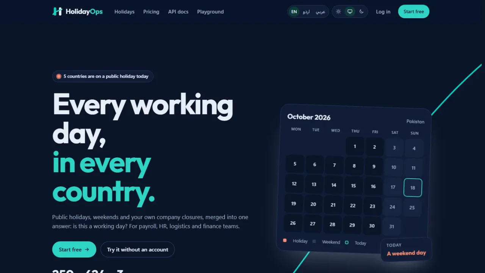
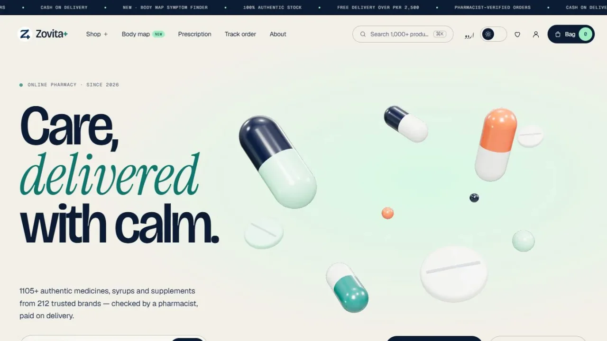
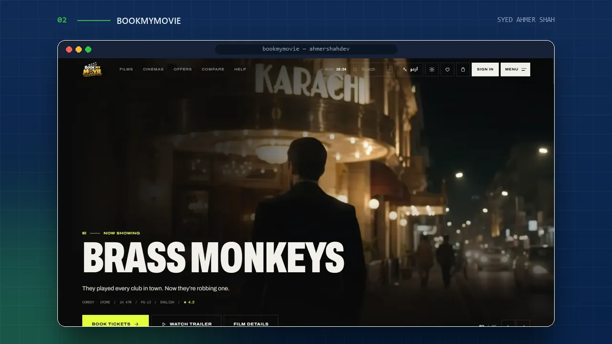
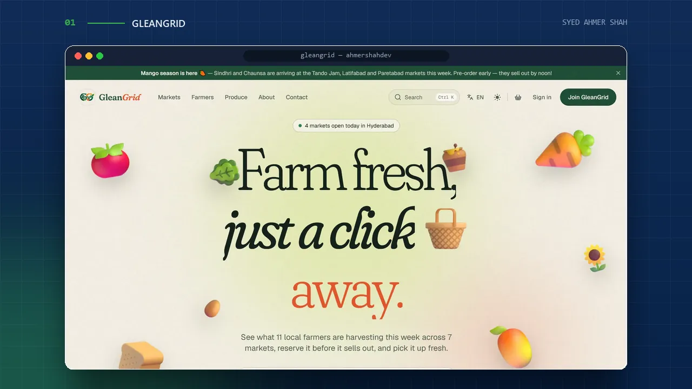
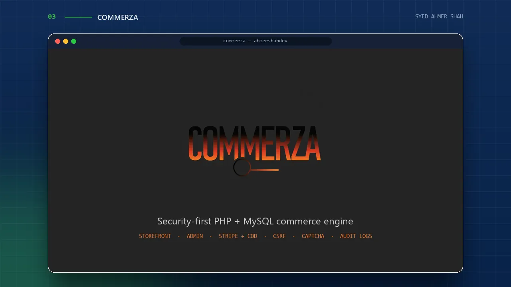

<!--
  Syed Ahmer Shah (@ahmershahdev) — Software Engineer & Full-Stack Developer (Laravel · Django · MERN · MySQL · Shopify),
  Software Engineering undergraduate from Hyderabad, Pakistan. Portfolio: https://ahmershah.dev/
-->

<a href="https://ahmershah.dev/">
  
</a>

<p align="center">
  
</p>

<p align="center">
  I design, build and ship web applications end to end — schema, backend, interface, security and deployment.<br>
  In 2026 I built <strong>five production-grade platforms solo</strong> and completed a full-stack internship at <strong>XCL Technologies</strong>.
</p>

<p align="center">
  <a href="https://ahmershah.dev/"></a>
  <a href="https://ahmershah.dev/docs/syed-ahmer-shah-resume.pdf"></a>
  <a href="https://linkedin.com/in/syedahmershah"></a>
  <a href="https://leetcode.com/u/syedahmershah"></a>
  <a href="https://www.fiverr.com/ahmershahdev"></a>
</p>

<p align="center">
  
  
  
  
  
</p>

<p align="center"><sub><a href="#01--about">About</a> &nbsp;·&nbsp; <a href="#02--selected-work">Selected work</a> &nbsp;·&nbsp; <a href="#03--stack">Stack</a> &nbsp;·&nbsp; <a href="#04--certifications">Certifications</a> &nbsp;·&nbsp; <a href="#05--education">Education</a> &nbsp;·&nbsp; <a href="#06--find-me-online">Find me online</a></sub></p>

---

## 01 — About

Software engineering undergraduate (BSE at HITMS + ADSE at Aptech, both to 2028) and full-stack developer. I care about the parts users never see — row-locked checkouts, verified payment webhooks, tenant isolation, clean schemas — so the parts they do see stay fast and trustworthy.

```js
const ahmer = {
  name: "Syed Ahmer Shah",
  role: "Software Engineer · Full-Stack Developer",
  basedIn: "Hyderabad, Pakistan · UTC+5 · open to remote",
  builds: ["Laravel + React (Inertia)", "Django REST + React", "PHP + MySQL"],
  strongest: { java: "advanced", dsa: "advanced · 676 LeetCode solved", sql: "row locking, views, constraints" },
  shipped2026: ["HolidayOps", "Zovita+", "BookMyMovie", "GleanGrid", "Commerza"],
  learningNext: ["Deeper Laravel", "TypeScript", "System design"],
  motto: "Design, Sync, Energize.",
};
```

---

## 02 — Selected work

<!-- ─────────────── 01 · HolidayOps ─────────────── -->

<a href="https://ahmershah.dev/projects/holidayops">
  
</a>

### 01 · HolidayOps — Working-Days API for 250 Countries

**Every working day, in every country.** A REST API, iCal feeds, digests and signed webhooks answering one question for payroll, HR and logistics teams: is this date a working day — here and in our other offices?

- **250 countries, 624 regions**, each with its own weekend rules (Friday–Saturday, Saturday–Sunday, Friday only)
- **Pure-Python domain layer with 100% branch coverage**; 481 automated tests across 43 pull requests
- **Security by default** — tenant isolation tested on every endpoint, hashed API keys, DNS-rebinding-proof SSRF guard, replay-proof TOTP
- English, Urdu and right-to-left Arabic; the public site is server-rendered with no JavaScript

<p>
  
  
  
  
  
  
  
</p>

<a href="https://ahmershah.dev/projects/holidayops"></a>
<a href="https://github.com/ahmershahdev/holidayops"></a>

<br><br>

<!-- ─────────────── 02 · Zovita+ ─────────────── -->

<a href="https://ahmershah.dev/projects/zovita">
  
</a>

### 02 · Zovita+ — Online Pharmacy Platform

A 1,186-product pharmacy across 8 departments with prescription upload, a **3D body-map symptom finder** and an English/Urdu interface.

- **Checkout in one transaction** — `SELECT … FOR UPDATE` in id order and a conditional stock decrement: stock can't be oversold, a double-submit returns the original order
- **Card payments confirmed only by HMAC-SHA256-verified, replay-protected Stripe webhooks**
- Staff admin with per-role permissions and TOTP 2FA, ClamAV upload scanning, 24 drug-interaction rules before payment, 201 automated tests

<p>
  
  
  
  
  
  
  
</p>

<a href="https://ahmershah.dev/projects/zovita"></a>
<a href="https://github.com/ahmershahdev/zovita"></a>

<br><br>

<!-- ─────────────── 03 · BookMyMovie ─────────────── -->

<a href="https://ahmershah.dev/projects/bookmymovie">
  
</a>

### 03 · BookMyMovie — Cinema Ticketing Platform

Browse films, watch trailers and pick seats on a live map — or from inside a **3D model of the hall** — then add snacks and book. 56-table schema with 9 reporting views, 49 screens.

- **Zero double-sold seats** — deterministic row-lock ordering, a database-enforced unique live-ticket key, idempotent checkout
- **Offline QR e-tickets** with Apple and Google Wallet passes, split bills, loyalty points and gift cards
- Back office for three roles with TOTP 2FA, ticket scanner, refunds and audit log; full Urdu RTL; Lighthouse 100 accessibility & SEO

<p>
  
  
  
  
  
  
</p>

<a href="https://ahmershah.dev/projects/bookmymovie"></a>
<a href="https://github.com/ahmershahdev/bookmymovie"></a>

<br><br>

<!-- ─────────────── 04 · GleanGrid ─────────────── -->

<a href="https://ahmershah.dev/projects/gleangrid">
  
</a>

### 04 · GleanGrid — Farmers-Market Pre-Orders · Aptech TechWiz 7

**Farm fresh, just a click away.** Customers reserve this week's harvest and collect it at the stall. Three role workspaces, 62 screens, 8 languages including right-to-left Urdu and Arabic.

- **A 50-process stress test** exposed a REPEATABLE READ stale-snapshot oversell (20 orders into a 3-place window); a locking read fixed it
- Idempotent payments with HMAC-verified gateway callbacks; live market map and QR pickup passes
- **133 PHPUnit tests (779 assertions)**, Playwright end-to-end and GitHub Actions on PHP 8.2 and 8.3

<p>
  
  
  
  
  
  
</p>

<a href="https://ahmershah.dev/projects/gleangrid"></a>
<a href="https://github.com/ahmershahdev/GleanGrid"></a>

<br><br>

<!-- ─────────────── 05 · Commerza ─────────────── -->

<a href="https://ahmershah.dev/projects/commerza">
  
</a>

### 05 · Commerza — Security-First E-commerce Engine

A framework-free production platform — **339 files, 136 commits**: storefront, admin with sub-admin roles, coupons, reviews, order tracking, Google and Facebook sign-in, Stripe and cash on delivery.

- **Transactional stock locking** and prepared statements on every write path
- CSRF tokens, reCAPTCHA v2/v3, Argon2id, ClamAV scanning, audit logs and SMTP failover
- **CI security gate on every push**

<p>
  
  
  
  
  
  
</p>

<a href="https://ahmershah.dev/projects/commerza"></a>
<a href="https://github.com/ahmershahdev/commerza"></a>

---

## 03 — Stack

<p align="center">
  <a href="https://ahmershah.dev/#skills">
    <picture>
      <source media="(prefers-color-scheme: light)" srcset="https://skillicons.dev/icons?i=php,laravel,java,python,django,js,ts,react,html,css,tailwind,bootstrap,nodejs,express,mongodb,mysql,git,github,vercel&perline=10&theme=light" />
      
    </picture>
  </a>
</p>

| Area | Skill · level — same scale as [ahmershah.dev](https://ahmershah.dev/#skills) |
|:---|:---|
| **Languages** | HTML5 `●●●●●` · CSS3 `●●●●●` · JavaScript `●●●●●` · Java `●●●●○` · PHP `●●●○○` · Python `●●●○○` |
| **Frameworks & UI** | Bootstrap `●●●●●` · React `●●●●○` · Laravel `●●●○○` · Tailwind CSS `●●○○○` |
| **Backend & data** | Node.js `●●●●○` · Express `●●●●○` · MySQL `●●●○○` · MongoDB `●●●○○` · SQL Server `●●●○○` · Django `●●●○○` |
| **Fundamentals** | Data structures & algorithms `●●●●○` · OOP `●●●○○` |
| **Platforms & tools** | Git `●●●●●` · GitHub `●●●●●` · SEO `●●●●●` · Shopify `●●●○○` |
| **AI toolkit** | ChatGPT · Claude · Claude Code · Codex · Gemini · DeepSeek |

---

## 04 — Certifications

The same 13 credentials shown on [ahmershah.dev](https://ahmershah.dev/#certificates) — every one links to the issuer's own verification page.

| Certificate | Issuer | Issued | Verify |
|:---|:---|:---|:---|
| Amazon Junior Software Developer | Amazon · Coursera | Mar 2026 | [Verify ↗](https://coursera.org/verify/professional-cert/NEGKTAK9KKN2) |
| Full Stack Web Development | Amazon · Coursera | Mar 2025 | [Verify ↗](https://coursera.org/verify/7GGU5A4WMN5H) |
| Full-Stack Web Development (PHP, HTML, CSS & JavaScript) | Board Infinity · Coursera | Mar 2026 | [Verify ↗](https://coursera.org/verify/specialization/AWJ2ZT3N85YT) |
| IBM DevOps and Software Engineering | IBM · Coursera | Mar 2026 | [Verify ↗](https://coursera.org/verify/professional-cert/ECD16Q89GXCD) |
| Meta Full Stack Developer (Front-End & Back-End) | Meta · Coursera | Mar 2026 | [Verify ↗](https://coursera.org/verify/specialization/4TU862MW0V5P) |
| Microsoft Full-Stack Developer | Microsoft · Coursera | Mar 2026 | [Verify ↗](https://coursera.org/verify/professional-cert/V6FN6XK6SEKF) |
| Fullstack Development | Scrimba · Coursera | Mar 2026 | [Verify ↗](https://coursera.org/verify/specialization/UHNV3UJ8ULTY) |
| Become a Software Developer | LinkedIn Learning | Mar 2025 | [Verify ↗](https://www.linkedin.com/learning/certificates/59c5bd7f8949c26268fea7e3bd9c4321f52f0c0bb6757edd8f3c06518b0d80b5) |
| Learning SQL Programming | LinkedIn Learning | Mar 2025 | [Verify ↗](https://www.linkedin.com/learning/certificates/81f714852a43a1c119ededdbc994335ad59c3df2355b5b0fe098d0a12dbed24d) |
| Succeeding in Web Development: Full Stack & Front End | LinkedIn Learning | Mar 2025 | [Verify ↗](https://www.linkedin.com/learning/certificates/682b0a7dbbfc148e89eb7531f6faefa2f915435e44d80849e3af01b0b8eec6ad) |
| JavaScript (Intermediate) | HackerRank | Mar 2026 | [Verify ↗](https://www.hackerrank.com/certificates/47DA08F71692) |
| SQL (Advanced) | HackerRank | Mar 2026 | [Verify ↗](https://www.hackerrank.com/certificates/C77C1661CD96) |
| Software Engineer Intern | HackerRank | Mar 2026 | [Verify ↗](https://www.hackerrank.com/certificates/B44B013B3E29) |

---

## 05 — Education

| Period | Institution | Program |
|:---|:---|:---|
| Nov 2024 – Dec 2028 | Hyderabad Institute for Technology & Management Sciences (HITMS) | Bachelor's in Software Engineering |
| Aug 2025 – Sep 2028 | Aptech Pakistan | Advanced Diploma in Software Engineering (ADSE) |
| Jul 2022 – Jul 2024 | Superior College of Science, Hyderabad | HSC, Pre-Engineering · Grade A |
| Apr 2012 – Jul 2022 | St. Bonaventure's High School, Hyderabad | SSC, Computer Science · A-1 |

---

## 06 — Find me online

<p align="center">
  <a href="https://ahmershah.dev/"></a>
  <a href="mailto:sales@ahmershah.dev"></a>
  <a href="https://calendly.com/syedahmershah"></a>
</p>

| Purpose | Profiles |
|:---|:---|
| **Hire me** | [](https://www.fiverr.com/ahmershahdev) [](https://www.upwork.com/freelancers/~01d033487ce8ecd83f) [](https://www.freelancer.com/u/syedahmershah) [](https://contra.com/syedahmershah) [](https://www.peopleperhour.com/freelancer/technology-programming/syed_ahmer-shah-syed-ahmer-shah-full-stack-web-zxqqamxq) [](https://www.guru.com/freelancers/syed-ahmer-shah) |
| **Career** | [](https://linkedin.com/in/syedahmershah) [](https://wellfound.com/u/syedahmershah) [](https://arc.dev/@syedahmershah) [](https://www.crunchbase.com/person/syed-ahmer-shah) |
| **Code & proof** | [](https://leetcode.com/u/syedahmershah) [](https://hackerrank.com/profile/syedahmershah) [](https://www.credly.com/users/syedahmershah/) |
| **Writing** | [](https://medium.com/@syedahmershah) [](https://dev.to/syedahmershah) [](https://hashnode.com/@syedahmershah) [](https://hackernoon.com/u/syedahmershah) [](https://substack.com/@syedahmershah) [](http://builder.aws.com/community/syedahmershah) [](https://coderlegion.com/user/syedahmershah) [](https://sessionize.com/syedahmershah) |
| **Reviews & business** | [](https://clutch.co/profile/syed-ahmer-shah) [](https://www.trustpilot.com/review/ahmershah.dev) [](https://www.g2.com/products/syed-ahmer-shah/reviews) [](https://www.designrush.com/agency/profile/syed-ahmer-shah) [](https://techbehemoths.com/company/syed-ahmer-shah) [](https://g.page/r/CS9yn4Q_UhZ4EBM) |
| **Social · @ahmershahdev** | [](https://instagram.com/ahmershahdev) [](https://youtube.com/@ahmershahdev) [](https://x.com/ahmershahdev) [](https://tiktok.com/@ahmershahdev) [](https://www.facebook.com/ahmershahdev) [](https://bsky.app/profile/syedahmershah.bsky.social) |
| **Links** | [](https://linktr.ee/syedahmershah) [](https://beacons.ai/syedahmershah) [](https://gravatar.com/syedahmershah) |

---

<p align="center">
  <a href="https://ahmershah.dev/"></a>
</p>

<p align="center"><em>"Designing order within the digital wilderness."</em><br><sub>— Syed Ahmer Shah</sub></p>

<p align="center">
  <a href="https://ahmershah.dev/#contact"></a>
</p>

<p align="center"><sub>© 2026 Syed Ahmer Shah</sub></p>
